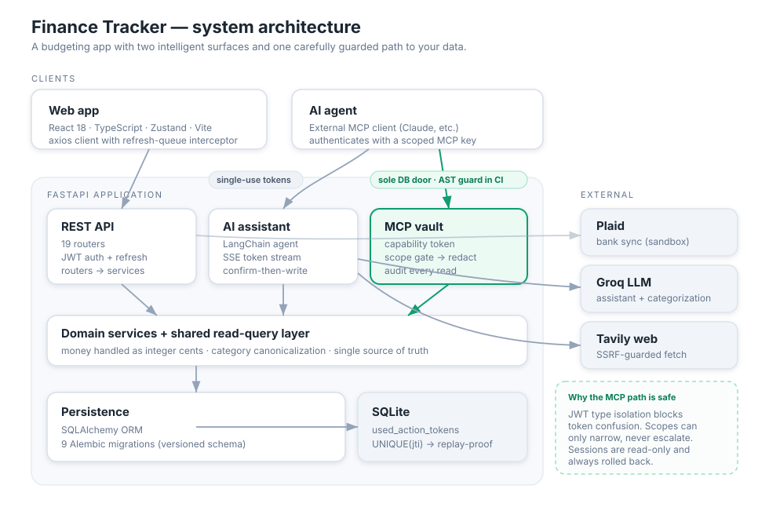
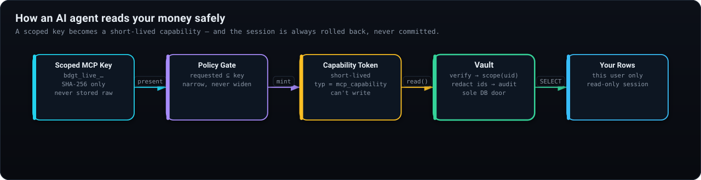

<div align="center">

# Finance Tracker

**A personal budgeting app that connects to your bank, learns how you spend, and lets an AI work with your money — without ever handing it the keys.**

Typed React frontend · FastAPI backend · a security model built so that *read access for an AI* never becomes *write access to your finances*.

<p>
  
  
  
  
  
  
  
</p>

</div>

---

## ✦ Highlights

- 🏦 **Bank sync** through Plaid — transactions categorized automatically, money learned per merchant.
- 📊 **Budgets, goals, recurring bills, net worth, forecasting** — each its own service, each its own tests.
- 🤖 **A built-in AI assistant** you can *talk to* — streamed token by token — that can also **make changes, but only after you confirm them**.
- 🔐 **A scoped, audited door for external AI agents** over MCP — so a tool like Claude reads your finances through a capability it can't widen, not a database connection.

The interesting engineering is in that last line. Here's how the whole thing fits together.

---

## Architecture

<p align="center">
  
</p>

<div align="center"><sub>Editable source: <a href="docs/architecture.excalidraw"><code>docs/architecture.excalidraw</code></a> — open in <a href="https://excalidraw.com">Excalidraw</a></sub></div>

Two invariants hold the system together:

> **One direction of flow.** Routers stay thin, services hold the logic, and **one shared read-query layer** is the single place transactions are fetched and shaped. The REST API, the in-app assistant, and the external MCP surface all read through that same layer — none grows its own copy.

> **One door to the database from anywhere untrusted.** Everything an outside agent can reach funnels through a single module that verifies, scopes, reads read-only, redacts, and audits. It's small enough to reason about — and a test makes sure it stays the *only* door.

---

## How an AI agent reads your money safely

This is the part to read first. An external agent **never touches the database**. It trades a scoped key for a short-lived capability, and every read passes through the vault.

<p align="center">
  
</p>

<div align="center"><sub>Editable source: <a href="docs/mcp-security.excalidraw"><code>docs/mcp-security.excalidraw</code></a></sub></div>

Every guarantee on that path is enforced in code, not by convention:

| Guarantee | How |
| --- | --- |
| **The DB boundary can't rot** | Only `vault.py` may import a database session. A CI test walks the AST of every other MCP module and fails the build on a violation — then plants a fake violation to prove the scanner bites. |
| **Three token types, never confused** | Auth tokens, assistant-action tokens, and MCP capability tokens each carry a distinct `typ` claim; every validator rejects the other two. A capability can't authorize a write; an access token can't be replayed as a capability. |
| **Capabilities only narrow** | Minting a capability asserts every requested scope is already on the key. Ask for more and you get a `PolicyError`, not a quietly broadened token. |
| **Nothing leaks into logs** | Every read emits one structured JSON line with the decision and latency — but parameters are stored as a truncated hash of their canonical form. No raw financial detail ever lands in a log. |
| **The session is never committed** | The vault opens read-only and **always rolls back**. A read literally cannot write. |

---

## Engineering notes

A few decisions that show how the codebase thinks. Each started as a real problem, not a checklist item.

**Confirm-then-write is replay-proof across machines.** The assistant *proposes*; the LLM never writes. A change applies only when you return a one-time token to the confirm endpoint. The single-use guarantee is a `UNIQUE` constraint on the token id in the database — not an in-process set — so it holds even behind a load balancer, even on a double-click.

**Money is integer cents, end to end.** Every amount is stored as whole cents and converted at the API seam with `Decimal`-based banker's rounding, so `10.99` never drifts. A dedicated migration moved the whole schema off floats without losing data.

**The web tool is hardened against SSRF and DNS rebinding.** When the assistant fetches a page, the host is resolved and validated across *every* record, redirects are followed manually and re-checked at each hop, and the socket is pinned to the exact IP that passed — so the address checked is the address dialed. TLS still verifies the real hostname.

**Token theft revokes the whole family.** Reusing an already-rotated refresh token (RFC 6819 §5.2.2.3) revokes every session in its lineage and commits immediately, so the revocation survives the 401's rollback.

**The frontend refresh flow can't deadlock.** A 401 triggers a refresh and queues the requests that arrived mid-flight — but the auth endpoints deliberately bypass that queue, because routing `/refresh` through it would make the app await a promise that only resolves *after* the await. The comment explains the trap so it isn't reintroduced.

---

## Tech stack

| Layer | Tools |
| --- | --- |
| **Frontend** | React 18 · TypeScript · Zustand · React Router · React Hook Form · Tailwind · Recharts · Vite |
| **Backend** | FastAPI · SQLAlchemy · Alembic · Pydantic · SlowAPI |
| **Intelligence** | LangChain · Groq · Tavily · Model Context Protocol (FastMCP) |
| **Integrations** | Plaid |
| **Auth & security** | JWT access + refresh tokens · bcrypt · scoped capability tokens |
| **Tooling** | Pytest · Vitest · ESLint · Docker · GitHub Actions |

---

## Quick start

```bash
pipenv install -d          # 1. backend deps
npm install                # 2. frontend deps
cp .env.example .env       # 3. fill in GROQ, PLAID, JWT_SECRET_KEY, …
python -m alembic upgrade head   # 4. database

pipenv run server          # 5a. FastAPI on :8000
npm run dev                # 5b. Vite on :5173
```

The MCP surface **ships dark**: it isn't mounted unless you set `mcp_enabled=true`. The app runs perfectly without ever exposing it.

---

## Project layout

```
server/src/
  routers/     thin HTTP layer (19 routers)
  services/    business logic — one concern per file
  mcp/         the agent surface — vault.py is the only DB door
  db/          models, session
  money.py     the dollars ↔ cents seam
  migrations/  versioned schema history
client/src/
  pages/       feature screens
  components/   UI + custom widgets
  store/       Zustand state
  lib/         api client, dates, colors
```

---

## Testing

The suite reads like a spec for the risky parts:

- `test_mcp_import_guard.py` — proves the database boundary holds, and proves the proof works.
- `test_assistant_security.py` · `test_mcp_policy.py` · `test_mcp_failure_modes.py` — scope escalation, token confusion, clean errors instead of stack traces.
- `test_money.py` — rounding and the cents seam.
- `test_completion_audit.py` · `test_mcp_vault.py` — redaction and audit shape.

```bash
pipenv run pytest        # backend
npm run test -- --run    # frontend
```

CI runs backend tests, frontend tests, ESLint, a TypeScript build, and a Docker image build on every push.

---

<div align="center"><sub>MIT © 2026 Advik Lall</sub></div>
